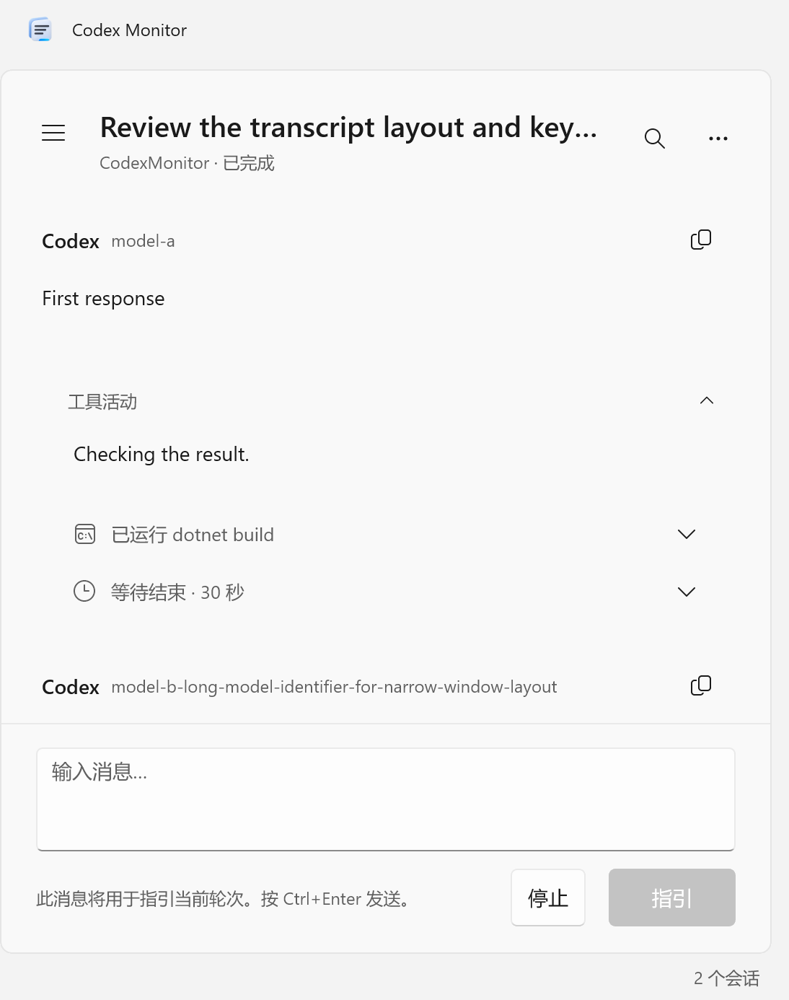

# Codex Monitor

[简体中文](README.zh-CN.md)

A Windows transcript viewer and lightweight Codex CLI client, built with C# and WinUI 3.

## Features

* Discover, search and read local conversations, archives and subagent activity.
* Display known models beside each Codex response without relabeling earlier turns.
* Read commands, patches, MCP results and waiting states. Activity groups start expanded and collapse to a category/count summary.
* Use one “Working” placeholder for observed non-message generation; text and reasoning stream directly.
* Automatically load older history as you scroll up, preserving the visible message and nested output.
* Answer Codex questions with options, free text or masked private input.
* Follow the system theme by default, with light/dark modes, RTL, high-DPI assets and 22 languages.
* NativeAOT releases and a per-user MSI installer.



## Install and use

Download the MSI and SHA-256 file from [Releases](https://github.com/RiversLee9312/CodexMonitor/releases). Supports Windows 10 1809 or newer and Windows 11. The .NET SDK is not required to run the app.

Local viewing does not start inference. Live connections require an installed, signed-in Codex CLI. Choose a Codex home in Settings or use discovery. **Connect app server** joins a running session’s owner; **Resume** loads eligible history so you can continue it. Sending and interrupting are explicit actions. An independent CLI process without a shared listener cannot be attached through the app-server protocol.

Local files are authoritative before attachment; app-server is authoritative after attachment. Disconnecting returns to local files. Settings and crash diagnostics are under `%LOCALAPPDATA%\CodexMonitor`.

## Protocol limits

Historical app-server items do not always include the model used for a reply. Missing information is left blank, not inferred from the provider or current configuration. Local `turn_context` and observed live model events supply labels when available.

App-server 0.164.0 does not expose the Responses API’s argument-generation delta stream. Its `item/started` event describes actual activity. The unified placeholder handles explicit generation/progress events supplied by the source; it does not invent an unobservable stage. Search and Markdown export cover the currently loaded window. Scroll upward to bring older history into that window. Unknown payloads retain folded source. Transcript JavaScript is parsed, never executed.

## Build and test

On Windows, install the .NET 10 SDK, Visual Studio C++ desktop build tools and a Windows SDK for NativeAOT.

```powershell
./scripts/Test.ps1
./scripts/Test-Layout.ps1
./scripts/Build-Installer.ps1
./scripts/Test.ps1 -IncludeRelease
```

UI tests use real WinUI windows, MSTest, screenshots and Axe.Windows; run them on an unlocked desktop. `-IncludeInstalledCli` opts into read-only CLI integration tests. Outputs are in `artifacts/`.

See [design](docs/design.md), [protocol coverage](docs/protocol-coverage.md), [history loading](docs/performance.md), [accessibility limits](docs/accessibility.md) and [contribution guidelines](CONTRIBUTING.md). Use synthetic sessions and redact private information in reports.

## License

[MIT](LICENSE). Dependencies retain their own licenses; see [third-party notices](THIRD-PARTY-NOTICES.md) and the in-app license page. This is an independent project, not an official OpenAI or Microsoft application. Report vulnerabilities using [the security policy](SECURITY.md).
