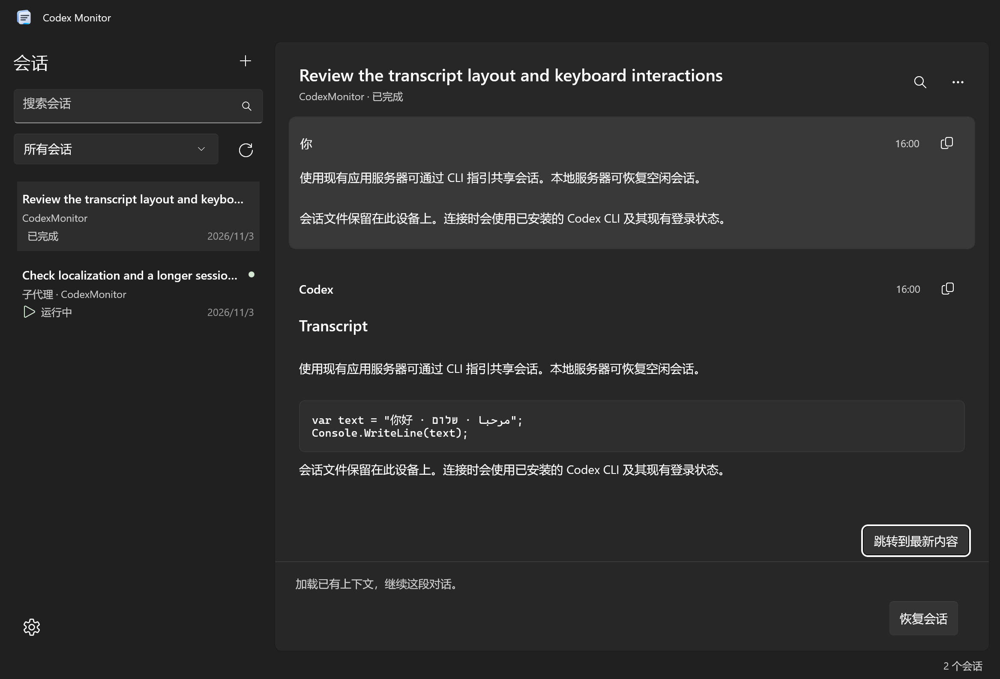

# Codex Monitor

用 C# / WinUI 3 编写的本地 Codex CLI 会话查看器与轻量客户端。

[下载 MSI 安装包](https://github.com/RiversLee9312/CodexMonitor/releases/latest)



## 运行

需要 Windows 11（推荐）或 Windows 10 1809+；源码构建需要 .NET 10 SDK。客户端使用 Windows App SDK 2.6.5，发布目录包含 .NET 和 Windows App SDK 运行时。启动本地服务器需要已安装并登录的 Codex CLI；本机已验证版本为 0.164.0。阅读已有记录和连接现有服务器不需要安装 CLI。

```powershell
dotnet build .\CodexMonitor.sln -p:Platform=x64
dotnet run --project .\src\CodexMonitor.App -p:Platform=x64
```

生成可直接运行的 x64 发布目录：

```powershell
.\scripts\Publish.ps1
```

输出为 `artifacts\publish\win-x64\CodexMonitor.App.exe`。整个发布文件夹需要一起保留，不是单文件程序。不需要管理员权限或安装 MSIX。

构建 MSI 安装包：

```powershell
.\scripts\Build-Installer.ps1
```

输出为 `artifacts\installer\CodexMonitor-0.1.4-win-x64.msi`，附带 SHA-256 校验文件。MSI 按当前用户安装到 `%LOCALAPPDATA%\Programs\CodexMonitor`，提供开始菜单入口和 Windows“已安装的应用”卸载项。包含 .NET 与 Windows App SDK 运行时，使用时无需安装开发 SDK。构建脚本会在项目的临时工具目录安装固定版本 WiX 4.0.6。

## 查看会话

默认读取 `CODEX_HOME`，未配置时读取用户目录下的 `.codex`。支持 `sessions`、`archived_sessions` 中的 JSONL rollout，包括子代理；索引标题缺失时从首条用户消息提取标题。

打开设置会自动查找 Codex 主目录：检查进程、用户、系统级 `CODEX_HOME`、已配置路径及当前用户默认 `.codex`，合并重复结果；也可重新查找或手动浏览。保留有效的现有路径与扫描期间的输入；缺失路径只有一个候选时自动填写。查找不遍历全盘、不读取凭据；仅在其他终端临时设置、又不属于这些位置的自定义目录需手动指定。WSL 的 Linux 主目录暂不自动发现。[官方目录规则](https://learn.chatgpt.com/docs/config-file/environment-variables)。

未安装 CLI 时，欢迎页和连接操作提供“设置 Codex CLI”，可打开官方安装说明、选择已有可执行文件或重新检查。设置会显示可用状态，并识别 PATH 中的 CLI、npm 原生包及 Windows 官方默认安装位置。未安装不会阻止本地记录阅读或保存设置；缺失主目录呈现空状态，启动本地服务器时才创建目录。

会话列表支持搜索标题、目录、ID、父会话 ID 与来源；筛选全部、活动或归档会话。对话支持原生可选择文本、代码块、简单 Markdown、复制、查找、自动跟随、工具活动折叠和 Markdown 导出。工具活动始终以紧凑折叠行显示，可逐项展开；向上滚动会暂停跟随，“跳至最新”恢复跟随。

会话内容更新会保留列表顺序、选择与现有条目；未阅读的更新以主题色小点标记，打开会话后清除。新增和删除会话也不会重播整个列表的过渡；保留阅读位置，新会话以小点提示。连接服务器后，服务器确认活动的会话显示播放形状的主题色图标和“运行中”文案；断线后立即移除该标识。

“上次记录的状态：活动”仅表示日志中最后一次生命周期记录为活动，不代表进程仍然运行。只有承载该会话的 app-server 能提供服务器已确认的活动状态。不会根据文件修改时间把会话假定为正在运行。

## 连接与 steer

设置中有两种连接方式：

* **本地应用服务器**：通过标准输入输出启动 `codex app-server`，复用 CLI 的现有登录和配置。可新建会话，或显式恢复已有空闲会话后发送消息。
* **现有应用服务器**：切换后自动扫描，选择发现的服务器即可填写地址，也可重新扫描或手动输入。支持已运行的 Codex 本地守护进程控制套接字和本机 Codex 进程的 IPv4/IPv6 WebSocket 监听。默认守护进程显示为 `unix://`，通过所选 Codex 主目录定位控制套接字。扫描只进行 `initialize` 握手，不启动服务器或推理回合。要同时使用终端和本工具操控同一个活动回合，二者需要连接同一个服务：

```powershell
# 单独的终端运行服务器
codex app-server --listen ws://127.0.0.1:4500

# 另一个终端连接同一个服务器
codex --remote ws://127.0.0.1:4500
```

会话底部的“连接应用服务器”自动查找实际承载此会话的服务器：先检查当前服务器，再扫描本机共享监听，并使用 `thread/loaded/list` 确认归属。只有历史记录的服务器不会被选中；找到多个运行时会让用户选择。确认归属后才用 `thread/resume` 加入现有运行时并订阅事件；扫描本身不恢复会话。打开活动会话时即检查可连接性，检查中显示进度；确认有对应运行时才显示连接按钮，找不到时直接显示原因。结果短暂缓存，切换会话取消旧检查，刷新或会话菜单可重新检查。缺少当前轮次 ID 时保持输入禁用并允许重试。

未连接时，底部只显示当前适用的一项操作及用途说明：已结束且未加载的历史会话可恢复已有上下文；活动中、已加载或状态未确认的会话只能连接其应用服务器。恢复前重新检查日志和服务器状态，发现活动会话就转为连接，不在其他运行时重复恢复。连接会话后，入口替换为输入框和发送按钮。无法连接时，感叹号和原因原位替换操作与说明，不显示横幅；会话菜单可重新检查。归档仅显示只读说明。

左下角仅保留设置。历史空闲会话用“恢复会话”继续，新建与恢复会按需建立设置中指定的服务器连接；“断开连接”位于会话菜单。空闲时发送会调用 `turn/start`；活动时按钮变为“引导”，调用携带 `expectedTurnId` 的 `turn/steer`。“停止”调用 `turn/interrupt`。过期回合不会被静默改成新回合，失败时保留输入文字。

CLI 可以连接共享后台服务器或使用 `--remote`；不能只凭 transcript 或会话 ID 推断能接管任意运行进程。官方文档没有给出把未暴露端点的运行进程热接入另一服务器的方法，详见 [连接能力核实](docs/connection-ownership.md)。本地服务器也不等于已有 CLI 的运行时。服务器拒绝恢复时会显示错误；归档会话保持只读。仅用 stdio 且没有共享监听的进程无法自动发现。WebSocket 目前仅接受无嵌入凭据的 loopback 地址；需要令牌的服务可标记为“需要身份验证”，尚不支持选择连接，远程主机和完整 Codex 工具交互亦未实现。支持命令与文件修改审批；未知的服务端交互请求会明确拒绝，不会自动允许。沙箱、审批策略和模型沿用 CLI 配置。

## 界面与语言

推理摘要和连续工具调用在同一活动区内按原顺序显示，推理摘要直接显示为正文；工具与事件默认折叠为一行。修改文件显示文件名和增删行数，命令显示可读摘要，已提供的耗时单独显示；完整参数、输出、差异在展开层查看并分别复制。一个补丁涉及多个文件时分行展示，导出仍保留原始调用。展开状态在实时更新时保留，长活动列表保持虚拟化；只显示可读推理摘要，不显示原始或加密推理。

`sleep` / `wait` 工具的时长参数识别为等待活动，显示设定时长、时钟及完成状态；只有服务器确认活动时才显示等待动画。历史记录不计时，也不凭设定时长伪造完成进度。原始参数和输出可在“详情”查看。

使用 Fluent Mica、原生 WinUI 控件、Windows 主题资源、可见焦点、系统对比主题、明确的按钮名称和键盘操作。宽度小于 900 DIP 时侧栏改为覆盖抽屉；消息和代码允许换行。设置与详情采用滚动对话框。浅色、深色与跟随系统均可在设置切换。

22 种语言：英语、简体中文、繁体中文、日语、韩语、法语、德语、西班牙语、意大利语、巴西葡萄牙语、俄语、乌克兰语、波兰语、荷兰语、瑞典语、丹麦语、芬兰语、土耳其语、阿拉伯语、希伯来语、印地语、印度尼西亚语。语言切换立即应用；阿拉伯语和希伯来语启用 RTL，代码和路径保持 LTR。日期与数字按所选语言格式化。翻译由 GPT-6 Luna（max 推理）生成，并做了资源完整性校验，尚未经过母语使用者审校。

快捷键：`Ctrl+L` 搜索会话，`Ctrl+F` 查找对话，`Ctrl+Enter` 发送或引导，`Ctrl+,` 打开设置，`F5` 刷新，`Esc` 关闭查找或窄屏侧栏。输入框中 Enter 换行。

## 测试

业务逻辑在独立的 `CodexMonitor.Core` 中，测试使用 MSTest 4.5.1 和 Microsoft.Testing.Platform。

```powershell
.\scripts\Test.ps1
.\scripts\Test.ps1 -IncludeInstalledCli
.\scripts\Test.ps1 -IncludeInstalledCli -IncludeRelease
.\scripts\Test-Layout.ps1
```

集成测试仅初始化 CLI、读取摘要，不启动推理回合。测试覆盖并发 RPC、取消/断连、错误传播、分页及子代理来源、steer 回合 ID、日志并发追加与残缺记录、加密推理隔离、工具合并、导出代码围栏以及全部语言的键和占位符。

布局测试使用真正的 WinUI UI 线程和生产界面源码，检查多尺寸边界、区域重叠、RTL、抽屉和标题栏主题同步，并输出 PNG 截图与 TRX 报告。截图位于 `artifacts\screenshots`。运行时会出现独立测试窗口，结束后自动关闭测试窗口。

`-IncludeRelease` 在发布后直接启动实际发布的程序，确认其能加载 XAML 并激活窗口。发布与安装包构建还会检查 PRI 和 XBF 资源是否齐全。

源码目录：`src\CodexMonitor.App` 为 WinUI 层，`src\CodexMonitor.Core` 为读取、协议与本地化层，`tests\CodexMonitor.Core.Tests` 为测试。设置存放在 `%LOCALAPPDATA%\CodexMonitor\settings.json`，崩溃信息保存在同目录 `crash.log`。应用不会直接修改 rollout，也不会单独读取或保存登录令牌。

设计依据见 [docs/design.md](docs/design.md)，内置 image_gen 的图标提示词与路径见 [docs/icon-generation.json](docs/icon-generation.json)，界面检查见 [docs/visual-review.md](docs/visual-review.md)，无障碍实现与验证边界见 [docs/accessibility.md](docs/accessibility.md)。

嵌套工具列表与长输出保留独立滚动位置；组内回看会暂停整段对话跟随，底部追加调用不会拉走正在阅读的位置。Microsoft Axe.Windows 扫描和 225% 字号压力布局纳入 MSTest；实际系统文字缩放与 Narrator 语音全流程仍需独立验证。
