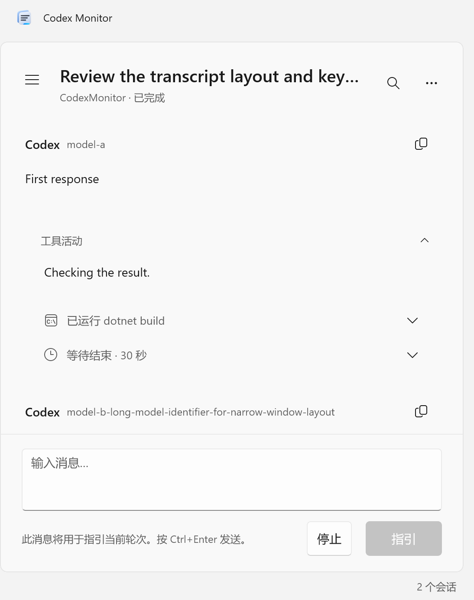

# Codex Monitor

[English](README.md)

用 C# 和 WinUI 3 编写的 Windows 会话查看器与轻量 Codex CLI 客户端。

## 功能

* 自动发现本地会话、归档和子代理，支持搜索与 Markdown 导出。
* 可按创建或更新时间检索今天、最近 7/30 天及自定义日期范围，并与关键词组合。
* 会话列表首批载入 50 行，滚动时自动续页；扫描与筛选在后台执行，旧查询可以取消。
* 向上滚动时自动分页加载历史，保留消息和嵌套工具组的阅读位置。
* 在每条 Codex 回复旁显示可用的模型记录，保留轮次间的模型变化。
* 命令、文件差异、MCP、等待与其他活动使用结构化布局；工具组默认展开，可收起为类别与数量概括。
* 已明确上报的非正文、非推理生成过程统一显示“工作中”，完成后原位替换。
* 回答 Codex 的选择题、自由回答或保密输入；提交需要明确操作。
* 默认跟随系统主题，支持深浅色、RTL、高分辨率图标和 22 种语言。
* NativeAOT 发布，MSI 按当前用户安装。



## 安装与使用

从 [Releases](https://github.com/RiversLee9312/CodexMonitor/releases/latest) 下载 MSI 和 SHA-256 文件。支持 Windows 10 1809+ 与 Windows 11，运行时无需安装 .NET SDK。

本地阅读不会启动推理。连接功能使用 Codex CLI 的应用服务器；启动本地服务器需要已安装并登录的 CLI。设置中可查找 Codex 主目录、现有应用服务器及 CLI。“连接应用服务器”加入承载会话的运行时；“恢复会话”载入可以继续的历史记录。界面依据会话状态二选一显示。没有共享监听端点的独立 CLI 进程无法通过 app-server 协议附加。

连接前以本地文件为唯一来源，连接该会话后以 app-server 为唯一来源，断线后返回本地文件。发送、指引、打断和恢复均需明确操作。本地状态不代表进程仍在运行。元数据索引缓存在应用自己的数据目录中，不为索引修改 Codex 文件。设置与故障诊断保存在 `%LOCALAPPDATA%\CodexMonitor`。

## 接口边界

历史 app-server 项不保证包含每轮实际模型，缺失时留空。本地 `turn_context` 和已观察到的模型事件提供可用标签，不用供应商名称或当前设置回填历史。

App-server 0.164.0 没有提供 Responses API 的参数生成增量，`item/started` 表示实际活动。统一占位只处理来源明确上报的生成状态，不猜测未观测到的阶段。已知工具使用共享适配器；未知扩展保留折叠原文。不会执行记录中的 JavaScript。

搜索与 Markdown 导出覆盖当前已加载范围，向上滚动可继续载入历史。更多细节见 [分页与性能](docs/performance.md)、[协议覆盖](docs/protocol-coverage.md) 和 [无障碍验证边界](docs/accessibility.md)。

## 构建与测试

源码构建需要 .NET 10 SDK；NativeAOT 还需要 Visual Studio 的“使用 C++ 的桌面开发”工具与 Windows SDK。

```powershell
./scripts/Test.ps1
./scripts/Test-Layout.ps1
./scripts/Build-Installer.ps1
./scripts/Test.ps1 -IncludeRelease
```

UI 测试使用真实 WinUI 窗口、MSTest、截图及 Axe.Windows，需要解锁的桌面。`-IncludeInstalledCli` 选择执行本机 CLI 的只读集成测试。输出在 `artifacts/`；发布目录需整体保留。设计约定见 [design](docs/design.md)，参与开发见 [贡献说明](CONTRIBUTING.md)。报告问题请使用合成记录并去除隐私信息。

## 许可证

项目采用 [MIT](LICENSE)。依赖保留各自条款，详见 [第三方说明](THIRD-PARTY-NOTICES.md) 和应用内许可证页面。本项目独立开发，不属于 OpenAI 或 Microsoft 官方应用。安全问题请按 [安全政策](SECURITY.md) 私下报告。
